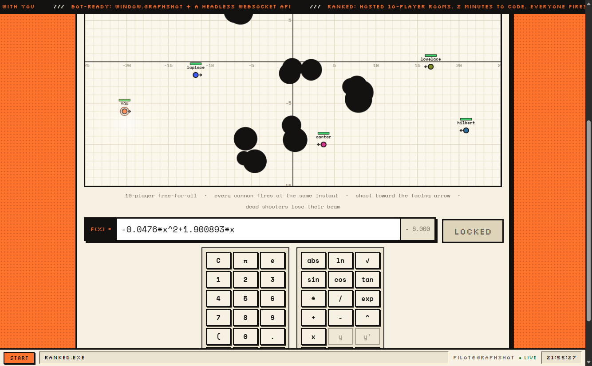
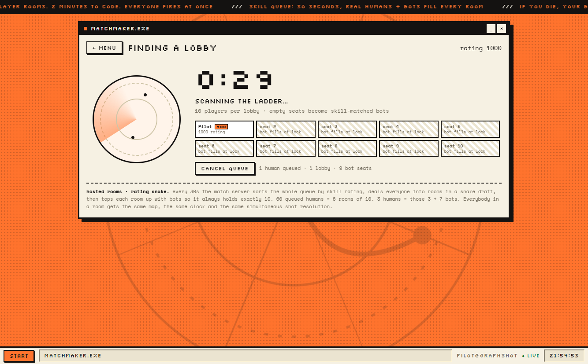
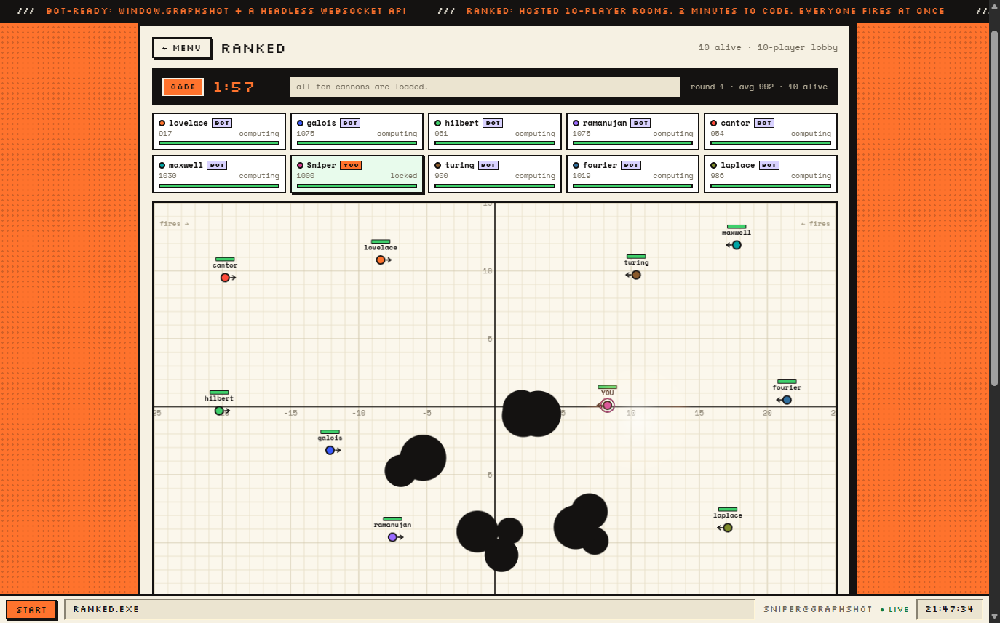
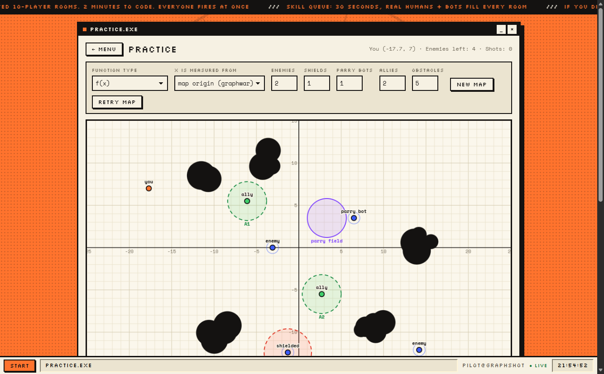

# GraphShot

A hosted 10-player math-artillery game. Real multiplayer rooms, skill matchmaking,
bot-filled empty seats, simultaneous beam resolution and a bot-friendly API.

## Gameplay Preview

| 10-Player Ranked Battlefield | Skill Matchmaking Radar |
| :---: | :---: |
|  |  |
| **Live Roster & Status Tracking** | **Sandbox Practice Mode** |
|  |  |

## Play

```bash
npm install
npm start
```

Open <http://127.0.0.1:8787>.

Fast local testing:

```bash
PORT=8787 FAST=1 npm start
```

Then open <http://127.0.0.1:8787/?name=you&token=you>. `?server=ws://…` overrides the
match server URL for proxies.

## Ranked in one paragraph

The queue gives human players a 30 second matchmaking window, sorts everyone by skill
rating and deals a rating-snake draft into rooms of exactly 10. Empty seats in a room
become bots whose rating is near the room average. Rooms are authoritative and hosted by
the Node server in `server/` (`npm start`).

Gameplay: 2 minute code phase (2:00 ranked, 10s with `FAST=1`) where every cannon writes
an equation and locks in; then all beams fire simultaneously for ~1-2 seconds.

- Health: every soldier starts with 100 HP; each landed hit deals 34 damage. The lobby
  runs multiple rounds; survivors are repositioned at least 6 units apart, then the next
  round starts. The lobby ends when one soldier/bot is left standing.
- Simultaneous resolution: all beams are resolved together, chronological, hits in the
  same instant land together; a dead shooter’s beam ends at death.
- Cannons can leave the vertical map area and come back, so parabola/quadratic equations
  work.
- Payouts: kills, survival time and placement bonus; losers still earn points.

## Bots

Write your own bot:

```bash
node bot.example.js
```

Or use the browser bridge:

```js
await GraphShot.findMatch();
await GraphShot.waitForPhase("code");
const plan = GraphShot.planShot();
GraphShot.submitShot({ expression: plan.expression, lock: true });
await GraphShot.waitForPhase("result", 180000);
```

Full protocol, state fields, map semantics and planning notes: [BOT_API.md](BOT_API.md).

## Tests

```bash
npm test          # hosted rooms: 3 humans + bot fill, 60 humans -> 6 rooms, reconnect
node test/smoke.js
```

## Deploy

```bash
PORT=8080 npm start
```

Server env vars: `PORT`, `HOST`, `DATA_DIR`, `FAST`, `QUEUE_MS`, `CODE_MS`, `COUNTDOWN_MS`, `ALLOW_CLOCK`.
